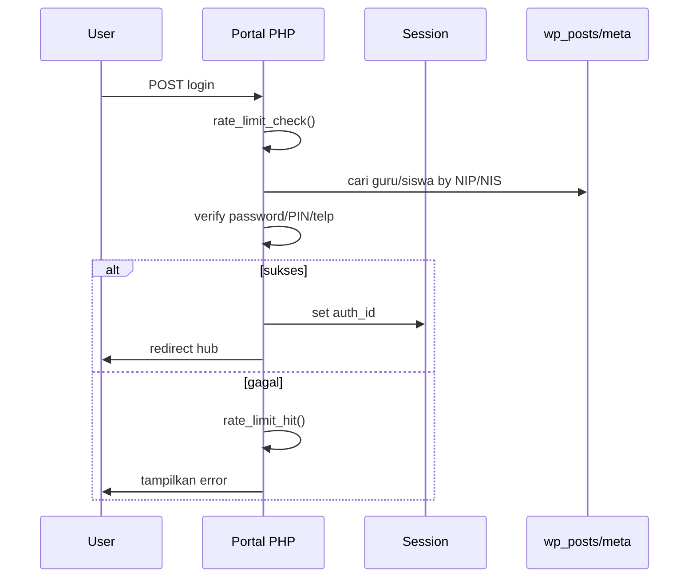

# Arsitektur Sistem — Plugin Sekolah

Dokumen ini menjelaskan arsitektur teknis plugin WordPress **Sekolah** (v1.7.1).

---

## 1. Gambaran Umum

Plugin ini dibangun sebagai **monolith modular** di atas WordPress:

- **Data layer:** Custom Post Types (CPT) + `post_meta`
- **Admin layer:** wp-admin menus, meta boxes, custom admin pages
- **Frontend layer:** Rewrite rules + `template_redirect` (portal tanpa tema)
- **Security layer:** Session PHP, nonces, rate limiting, capability checks

```
┌─────────────────────────────────────────────────────────────┐
│                     WordPress Core                          │
│  (posts, meta, users, options, transients, rewrite API)     │
└──────────────────────────┬──────────────────────────────────┘
                           │
┌──────────────────────────▼──────────────────────────────────┐
│                    index.php (Bootstrap)                     │
│  • Konstanta QRG_*                                           │
│  • require includes/*.php                                    │
│  • Dashboard admin + AJAX layout                             │
└──────────────────────────┬──────────────────────────────────┘
                           │
     ┌─────────────────────┼─────────────────────┐
     │                     │                     │
┌────▼────┐         ┌──────▼──────┐       ┌──────▼──────┐
│ Admin   │         │  Portal     │       │  Security   │
│ Modules │         │  Frontend   │       │  Helpers    │
└────┬────┘         └──────┬──────┘       └─────────────┘
     │                     │
     │    CPT + Meta       │    Session Auth
     └──────────┬──────────┘
                │
         ┌──────▼──────┐
         │  MySQL DB   │
         │  wp_posts   │
         │  wp_postmeta│
         │  wp_options │
         └─────────────┘
```

---

## 2. Bootstrap & Modul

File `index.php` memuat modul secara berurutan:

| Urutan | File | Tanggung jawab |
|--------|------|----------------|
| 1 | `security.php` | Session, rate limit, upload safe |
| 2–15 | `kelas.php`, `guru.php`, … | CPT & admin per domain |
| 16 | `akuntansi.php` | Keuangan, RKAS, pembelian |
| 17 | `frontend.php` | Auth pembayaran, intercept URL |
| 18 | `portal-sekolah.php` | Portal `/sekolah/` |
| 19 | `portal-guru.php` | Portal `/guru/` |
| 20+ | `export-import.php`, `psb.php`, … | Utilitas |

**Prinsip:** satu file = satu bounded context. Cross-module via fungsi `qrg_*` publik.

---

## 3. Custom Post Types (CPT)

Semua entitas bisnis disimpan sebagai CPT `master_*`:

| CPT | Modul | Meta kunci (contoh) |
|-----|-------|---------------------|
| `master_guru` | guru.php | `_guru_nip`, `_guru_telp`, `_guru_jabatan_id` |
| `master_siswa` | siswa.php | `_siswa_nis`, `_siswa_kelas_id`, `_siswa_portal_pin`, email |
| `master_kelas` | kelas.php | `_kelas_tingkat`, `_kelas_jurusan` |
| `master_mapel` | mapel.php | `_mapel_kode`, guru pengampu |
| `master_jadwal` | jadwal.php | `_jadwal_hari`, `_jadwal_guru_id`, `_jadwal_mapel_id`, jam |
| `master_jurnal` | jurnal.php | `_jurnal_guru_id`, `_jurnal_materi`, `_jurnal_tanggal` |
| `master_tugas` | pembelajaran.php | `_tugas_guru_id`, `_tugas_kelas_id`, deadline, tipe |
| `master_jawaban` | pembelajaran.php | `_jawaban_tugas_id`, `_jawaban_siswa_id`, nilai |
| `master_tagihan` | tagihan.php | `_tagihan_siswa_id`, `_tagihan_status`, nominal |
| `master_gaji_guru` | gaji-guru.php | `_gaji_guru_id`, `_gaji_status`, komponen |
| `master_pembelian` | akuntansi.php | `_pembelian_total`, `_pembelian_status` |
| `master_rkas` | akuntansi.php | anggaran, realisasi, program |
| `master_presensi_guru` | presensi-guru.php | tanggal, status kehadiran |
| `master_psb` | psb.php | data pendaftar, status |
| `master_inventaris` | inventaris.php | aset sekolah |
| `master_biaya` | biaya.php | komponen biaya |
| `master_ruangan` | ruangan.php | ruang belajar |
| `master_jabatan` | jabatan.php | jabatan struktural |
| `master_jalur` | jalur.php | jalur PSB |

**Catatan keamanan:** CPT sensitif (`master_guru`, `master_psb`, `master_siswa` tanpa endpoint) **diblokir** di frontend via `template_redirect`.

---

## 4. Portal Frontend

### 4.1 Portal Siswa (`portal-sekolah.php`)

```
Request: GET /sekolah/pembayaran/
    │
    ▼
Rewrite: qrg_sekolah_portal=pembayaran
    │
    ▼
template_redirect → qrg_render_sekolah_portal()
    │
    ├── Auth: session qrg_pembayaran_siswa_id
    ├── Google AJAX → qrg_ajax_google_portal_login
    └── Render HTML standalone (tanpa theme)
```

**Session key:** `$_SESSION['qrg_pembayaran_siswa_id']`

### 4.2 Portal Guru (`portal-guru.php`)

```
Request: GET /guru/jadwal/?baru=1&kelas_id=5
    │
    ▼
Rewrite: qrg_guru_portal=jadwal
    │
    ▼
template_redirect → qrg_render_guru_portal('jadwal')
    │
    ├── Auth: session qrg_guru_portal_id
    ├── Verify: NIP + normalize(telepon)
    └── Sub-views: jadwal, gaji, presensi, tugas monitor, jurnal
```

**Session key:** `$_SESSION['qrg_guru_portal_id']`

### 4.3 Diagram Alur Auth Portal



---

## 5. Modul Keuangan

```
                    ┌─────────────┐
                    │  Tagihan    │──► Pemasukan (status Lunas)
                    │  Siswa      │
                    └──────┬──────┘
                           │
┌─────────────┐     ┌──────▼──────┐     ┌─────────────┐
│    RKAS     │     │  Saldo Kas  │     │     DSS     │
│  (anggaran) │────►│  Dashboard  │────►│  (analisis) │
└─────────────┘     └──────▲──────┘     └─────────────┘
                           │
              ┌────────────┴────────────┐
              │                         │
       ┌──────▼──────┐          ┌──────▼──────┐
       │ Gaji Guru   │          │ Pembelian   │
       │ (Dibayar)   │          │ (Lunas)     │
       └─────────────┘          └─────────────┘
              └──► Pengeluaran ──┘

Jurnal Pembukuan: gabung transaksi tagihan/gaji/pembelian → buku kas
```

Fungsi kunci:
- `qrg_akuntansi_get_jurnal_pembukuan()` — buku kas
- `qrg_akuntansi_build_dss()` — skor kesehatan keuangan
- `qrg_rkas_get_summary_stats()` — ringkasan RKAS

---

## 6. Modul Pembelajaran

```
master_mapel / master_jadwal
        │
        ▼
  master_tugas ──────► master_jawaban
   (guru, kelas)        (siswa, file, nilai)
        │
        ▼
  master_jurnal
  (materi, kegiatan)
```

Portal guru membuat tugas/jurnal dari slot jadwal dengan pre-fill `mapel_id` + `kelas_id`.

Matching tugas/jurnal ke slot:
- `qrg_guru_portal_match_tugas_for_slot()`
- `qrg_guru_portal_match_jurnal_for_slot()`

---

## 7. Admin Dashboard

Dashboard (`qrg_master_dashboard_callback` di `index.php`):

- Layout disimpan per user: `user_meta` key `qrg_dashboard_layout`
- AJAX save: `wp_ajax_qrg_save_dashboard_layout`
- Widget & summary cards dirender server-side PHP

---

## 8. Rewrite Rules & Flush

Setiap fitur URL custom mendaftarkan rewrite + flush sekali via option:

| Option | Modul |
|--------|-------|
| `qrg_security_rewrite_flushed_v1` | security |
| `qrg_sekolah_portal_rewrite_flushed_v2` | portal-sekolah |
| `qrg_guru_portal_rewrite_flushed_v1` | portal-guru |
| `qrg_pembayaran_rewrite_flushed_v1` | frontend |
| `qrg_pembelajaran_rewrite_flushed_v1` | pembelajaran |

Pattern: `add_action('admin_init', ...)` cek option → `flush_rewrite_rules(false)` → set option.

---

## 9. Keamanan

| Lapisan | Implementasi |
|---------|--------------|
| Admin | `manage_options`, nonces |
| Portal login | Rate limit 8×/15 menit per IP |
| Session | `HttpOnly`, `Secure` (SSL), `SameSite=Lax` |
| Upload | MIME whitelist, block ekstensi berbahaya |
| Redirect | `wp_validate_redirect` / `qrg_safe_redirect_url` |
| Frontend CPT | Block singular guru/psb/siswa |

---

## 10. Dependensi Eksternal

| Layanan | Penggunaan |
|---------|------------|
| Google OAuth | `https://oauth2.googleapis.com/tokeninfo` — verifikasi ID token |
| WordPress APIs | CPT, meta, AJAX, upload, transients |
| Dashicons | Ikon admin & aksi cepat keuangan |

Tidak ada Composer/npm dependency — pure PHP WordPress plugin.

---

## 11. Tools Development

Folder `tools/` berisi script CLI/web dummy data. **Tidak dimuat** oleh `index.php` — dijalankan manual untuk pengujian.

---

## 12. Ekstensi Arsitektur (Rekomendasi)

Jika proyek berkembang:
1. **Service layer** — pisahkan query bisnis dari render HTML
2. **REST API** — `register_rest_route` untuk integrasi mobile
3. **Repository pattern** — abstraksi CPT query
4. **Unit tests** — PHPUnit + WP test suite

Saat ini sengaja flat & WordPress-native untuk kemudahan deploy shared hosting.
